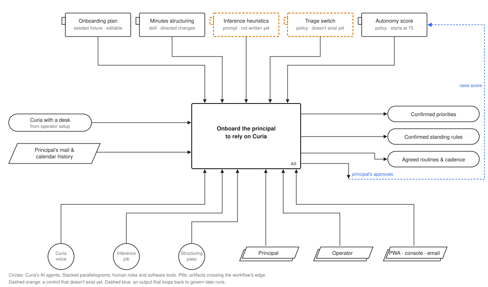
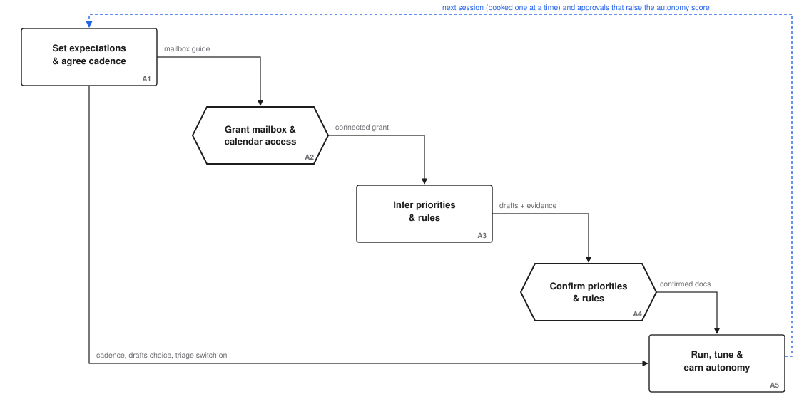

# Principal onboarding: a HAWD model

**Status:** Draft, 2026-10-30
**Companion to:** `docs/wip/2026-10-29-onboarding-journey-design.md` (the design). This model
describes the same journey from the principal's side and records what it changed in the design.
**Notation:** [Human-AI Workflow Design (HAWD) v0.9](https://github.com/overlapping-brock/hawd-standard),
by Brock Hart, Overlap. Licensed CC BY 4.0; Overlap is the originating studio.

## How to read this

HAWD extends IDEF0. Every step is a box with four kinds of arrow:

- **Inputs** enter from the left. The step transforms them.
- **Controls** enter from the top. They govern how the step runs and are not used up by it.
  Prompts, playbooks, policies and settings are controls.
- **Outputs** leave to the right.
- **Mechanisms** enter from the bottom. They do the work: people, tools and AI agents.

Shapes carry the role:

| Shape | Meaning |
|---|---|
| Rectangle | A step |
| **Hexagon** | A human judgment checkpoint: a step where a person must decide, and the decision can't be handed to anyone else |
| Tabbed rectangle | A control |
| **Circle** | An AI agent doing the work |
| Stacked parallelogram | A human role or software tool doing the work |
| Pill | An artifact crossing the edge of this workflow, in from another one or out to the next |
| Parallelogram | A data object passing through |

Two conventions are this model's own, not HAWD's: **dashed orange** marks a control that doesn't
exist yet, and **dashed blue** marks an output that loops back to govern later runs.

## Model frame

- **Viewpoint:** the principal. The operator's install and desk setup are a separate workflow.
  Here they arrive as one input, "Curia with a desk".
- **Purpose:** to document how the principal moves from a freshly set-up Curia to relying on it
  for real work, showing where they decide, what governs Curia's work around those decisions,
  and what they can see and check.
- **Questions the model must answer:**
  - **Q1 Expectations.** Before Curia changes anything the principal can see (mail labelled and
    leaving the inbox, holds or moves on the calendar, drafts piling up), how did they come to
    expect it?
  - **Q2 Check-ins.** Where does Curia check with the principal before acting, and how do those
    check-ins taper off as alignment is shown?
  - **Q3 "It gets me."** What governs Curia's inferences about the principal, and where do they
    edit a draft instead of filling in a blank page?

Confidence takes a couple of weeks, not one call. The design's "onboarding is done" point (priorities
confirmed, one routine agreed) marks the end of *capture*. Reliance builds after it, in A5.

## A0: context

**Onboard the principal to rely on Curia (A0)**

- **Inputs:** Curia with a desk (from the operator's setup); the principal's mail and calendar
  history.
- **Controls:**
  - **Onboarding plan.** Seeded at kickoff from a fixture in the repo; the principal may edit it.
  - **Minutes structuring.** The existing `meeting-minutes-structuring` skill.
  - **Inference heuristics.** Not written yet (#2362).
  - **Triage switch.** Doesn't exist yet (#2360).
  - **Autonomy score.** Starts at 75, approval-required.
- **Outputs:** confirmed priorities; confirmed standing rules; agreed routines and the next
  session; the principal's approvals, which loop back to raise the autonomy score.
- **Mechanisms:** Curia voice, the inference job and the structuring pass (AI agents); the
  principal; the operator; the PWA, console and email.

## Decomposition: A1–A5

Only A2 and A4 are checkpoints. Check-ins in A5 are deliberately not: the autonomy score governs
them.

### A1: Set expectations and agree the next session

The first call, and the opening of every later one. Curia runs it from an agenda generated from
the onboarding plan shortly before the call.

- **Input:** Curia with a desk; what the principal says about how they work.
- **Controls:**
  - **Onboarding plan**, including the **"what to expect" topic**. Its content is built from
    Curia's current settings when the agenda is generated, so it never promises behaviour Curia
    won't show:
    - **Inbox:** Curia labels mail and archives some of it, so mail will leave the inbox on purpose,
      and here is where it goes.
    - **Calendar:** Curia may place tentative holds without asking (risk 70). Creating or moving
      real meetings asks first at the starting autonomy score (risk 80).
    - **Drafts:** Curia sometimes leaves reply drafts unsent. It asks: "Do you think you'll see
      those, or would you rather I send you an end-of-day reminder if there are drafts left
      unsent?"
    - **Check-ins:** "For now I'll check with you before booking or moving meetings. As you
      approve things, I'll ask less."
  - **Nudge policy:** copy and frequency cap. Not written yet.
- **Outputs:** minutes; the next session booked and the plan's progress updated; the
  drafts-handling choice, with a reminder routine if wanted; the triage switch turned on once the
  principal has heard what to expect; the mailbox guide sent.
- **Mechanisms:** Curia voice (AI); the structuring pass (AI); the principal.

Sessions are booked **one at a time**, at the end of each call, as the principal's interests and
availability shift. Nothing is created up front.

### A2: Grant mailbox and calendar access (checkpoint)

- **What's decided:** whether Curia gets delegated access to the principal's own mail and calendar.
- **Criteria:** the principal understands what Curia will and won't do with it, as explained in A1.
- **Mechanisms:** the principal decides. The operator may do the Nylas steps if someone set Curia
  up for them, but the consent stays the principal's.
- **Outcomes:**
  - **Granted:** the grant is detected at boot (the guide says to restart), which starts A3.
  - **Not yet:** Curia keeps working from its own inbox. The plan keeps the topic open for a
    later session. A3 and A4 wait.
- **Output:** the connected grant.

### A3: Infer priorities and rules

- **Input:** about 90 days of calendar and sent mail.
- **Controls:**
  - **Inference prompt and evidence heuristics.** Not written yet. This is the step that most
    decides whether Curia "gets" the principal, and it is the one with no written control.
  - **The principal's existing rules:** keep them, and flag conflicts.
- **Outputs:** draft priorities, draft inbox rules and draft calendar rules, each item with the
  evidence behind it.
- **Mechanisms:** the inference job on the strongest tier (AI); the principal's mailbox.

One read of the history produces all three drafts (#2362).

### A4: Confirm priorities and rules (checkpoint)

- **What's decided:** which inferred priorities and rules are true of the principal.
- **Criteria:** the evidence shown with each item.
- **How:**
  - **Priorities:** walked through on the next call. The principal confirms, corrects or drops each
    one.
  - **Rules:** Curia raises a few of the strongest on the call ("I noticed you never take meetings
    before 9. Should I protect that?"). It emails the full list afterwards as a numbered draft, and
    the principal replies in plain words.
- **Outcomes:**
  - **Confirmed or corrected:** written to `/shared/principal/priorities.md`,
    `/shared/inbox/rules.md` or `/shared/calendar/rules.md`.
  - **Dropped:** not written.
  - **No reply to the rules email:** nothing is written.

  After applying a reply, Curia sends a **receipt** listing the rules as written, with a console
  link to each document. The receipt doesn't wait for an answer.
- **Control:** the session agenda, generated by Curia from the onboarding plan.
- **Mechanisms:** the principal decides; Curia voice; email; the console.

### A5: Run, tune and earn autonomy

- **Inputs:** confirmed priorities and rules; agreed routines.
- **Controls:**
  - **Autonomy score:** 75, approval-required, at the start.
  - **Triage switch.**
  - **Minutes structuring:** for tuning sessions.
- **Outputs:**
  - **Visible work:** labels, holds, drafts and recaps.
  - **The principal's approvals and denials:** the daily scoring pass turns them into autonomy
    score changes once 30 actions have been scored.
- **Mechanisms:** ceo-inbox, calendar and coordinator (AI); the scheduler; the principal.

Later sessions shift from capturing to tuning and loop back to A1's agenda.

## What the model answers

- **Q1 Expectations.** A1's "what to expect" topic tells the principal what is coming. The triage
  switch makes it true: triage stays off until the principal has heard it. The drafts question
  closes the one route where work could sit unseen.
- **Q2 Check-ins.** The autonomy score governs them. At 75, creating or moving meetings (risk 80)
  asks first; tentative holds (risk 70) don't, so A1 names them.
  As the principal approves actions, the score rises and the check-ins stop. No new mechanism is
  needed, only the plain-words explanation in A1.
- **Q3 "It gets me."** A3 drafts priorities and rules from the principal's own history. A4 turns
  them into edits instead of a blank page, and the receipt shows the result.

## Gaps: controls that must exist before this runs

| Control | Step | Status | Tracked in |
|---|---|---|---|
| Inference prompt and evidence heuristics | A3 | Not written; now a written deliverable of #2362 | #2362 |
| Triage switch (`ceo_inbox/triage`, off until A1) | A1, A5 | Doesn't exist | #2360 |
| "What to expect" topic, built from current settings | A1 | Not in the first-call agenda | #2360 |
| Onboarding plan fixture (topics and progress) | A1, A4 | Was one plan per principal, with *N* sessions created up front | #2360 |
| Minutes structuring allows booking the next session and writing the plan | A1 | Its in-bounds list covers tasks and invite updates only | #2360 |
| Nudge policy (copy, frequency cap) | A1 | Left to the builder | #2360 |

## Glossary

| Term | Meaning in this model |
|---|---|
| **Principal** | The executive Curia works for. |
| **Operator** | Whoever installed Curia and set up its desk. Often the principal; sometimes an assistant or IT. |
| **Desk** | Curia's own email, a way to message the principal (the PWA by default), and voice. |
| **Onboarding plan** | One editable document per principal, seeded from a repo fixture at kickoff. It holds *what to cover* (sessions, topics) separately from *what's happened* (covered, left, the principal's timing and interests), so the agenda generator can tell "skipped" from "not part of onboarding". |
| **Directed change** | Something the principal explicitly asked for on a call. The minutes structuring skill carries it out (still within the autonomy score). Suggestions nobody asked for are mentioned, not done. |
| **Receipt** | A message sent after Curia applies a change, showing the result. It doesn't wait for a reply. Distinct from a **check-in**, which asks before acting. |
| **Autonomy score / band** | A 0–100 setting that decides which actions need the principal's approval. New installs start at 75, "approval-required". |
| **Standing rules** | The principal's inbox and calendar rules, one `##` section per rule, in `/shared/inbox/rules.md` and `/shared/calendar/rules.md`. |
| **Triage switch** | A ceo-inbox config value that turns scheduled triage on or off. Written off at kickoff on a fresh install; missing means on, so existing installs are unaffected. |
| **Draft (priorities or rules)** | An inference not yet confirmed. Nothing acts on it. |

## Notes on applying HAWD

This is a first application of HAWD v0.9 to Curia, and these notes record how it went.

**Where it helped.**

- **Undocumented controls.** Drawing the control rail surfaced controls that didn't exist. Two
  sat exactly on the steps that answer Q1 and Q3. The design had parked them under "left to the
  builder".
- **Checkpoints.** The checkpoint discipline cut the hexagons to two. A first pass put a
  checkpoint at every conversational decision. The standard's own warning against "using the
  human judgment checkpoint for routine reviews" was right, and the autonomy score was the better
  answer.
- **Viewpoint.** Choosing one viewpoint moved install and desk setup out of the model. It also
  showed that the design's "done" is the end of capture, not reliance.
- **The feedback loop.** HAWD's fourth worked example has outputs that return as controls. That
  matched Curia twice: approvals feeding the autonomy score, and session outcomes feeding the
  onboarding plan.

**Where it strained.**

- **Time.** A diagram is a fixed picture, but check-ins taper and sessions are booked one at a
  time. Loops show this only loosely. The node narratives carry it.
- **Branches.** "Voice not working yet" has no place in the notation. It stays in the design's
  Phase 2.
- **Decisions captured by an AI.** The principal decides on a call, but the decision reaches the
  system through minutes an AI wrote. HAWD has no mark for that hand-off. The minutes structuring
  skill and its confirmation message are the control here.
- **Agent-authored controls.** HAWD v0.9 names these as unresolved. Here each agenda is written
  by Curia, but always from a plan a human wrote and the principal can edit. That keeps the
  agent-authored control inside a human-authored one, which may be a useful pattern for the
  standard's open question.
- **Feel.** Anti-goals about how things feel, like "a requirements list that reads like a wall",
  are outside what HAWD models.
